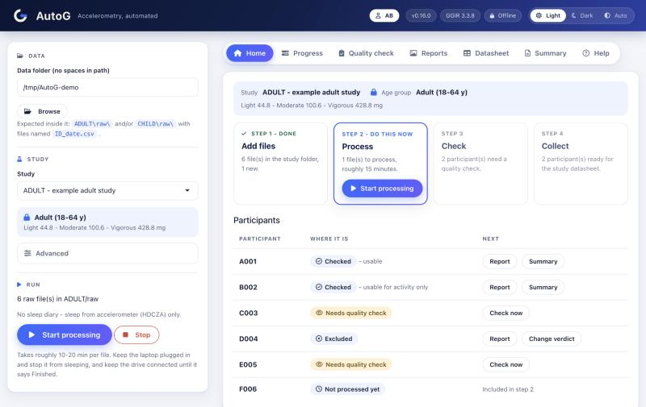
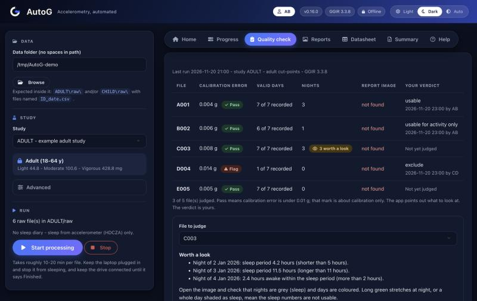
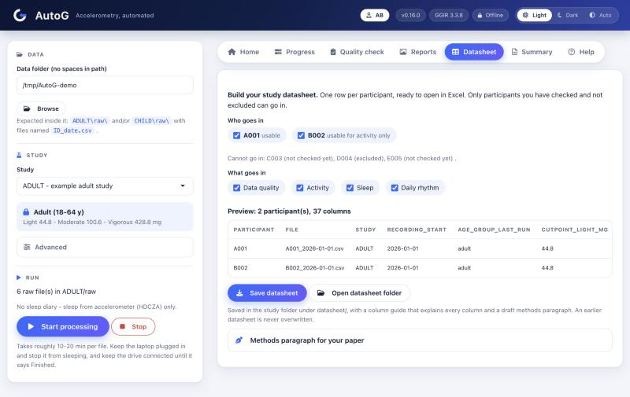
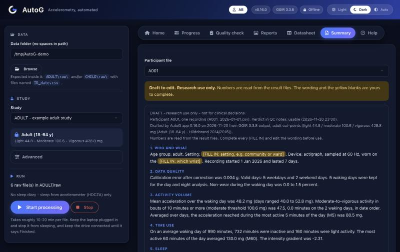

<h1 align="center">AutoG</h1>

<b>Accelerometry, automated.</b> 
An offline, point-and-click front end for <a href="https://github.com/wadpac/GGIR">GGIR</a>, built for locked-down laptops and people who don't code.

> **Research use only.** AutoG is not a medical device. Its outputs describe a recording; they are
> not for diagnosis, monitoring or decisions about an individual. The screenshots show an invented
> demo study.

## What it does

Wrist accelerometers record a week of raw movement. GGIR, the open-source R package, turns that
into activity, sleep and rhythm outcomes, but it has more than 300 arguments and needs R. AutoG
wraps a fixed, documented GGIR configuration in an app that:

- **runs with no internet and no admin rights**: one folder with portable R and locked packages,
  started by double-clicking a `.bat` file; the interface lives only at `127.0.0.1`
- **keeps the science fixed**: every GGIR setting is pinned; the one choice that changes results,
  the age group (which sets the cut-points), is fixed per study and always visible
- **guides non-technical users** through four steps: add files, process, check, collect
- **makes people judge quality**: it points out what is worth a look (calibration, short or long
  nights, daytime sleep, nights without a diary entry); a person records the verdict
- **produces, per participant**, a report image, a draft written summary in which every number is
  traced to the GGIR file and column it came from, and a row in a **study datasheet** (CSV with a
  column guide and a draft methods paragraph)
- **keeps a record**: who processed and checked what (initials), with which version and settings

Light, dark and auto mode throughout, including the PDFs.

## The playbook

AutoG was built by a clinician-researcher with an AI coding assistant, under a method that keeps
people in charge of the science: one source of truth, fixed settings, numbers traced to their
source, a person's verdict on every recording, and checks at every release. **[PLAYBOOK.md](PLAYBOOK.md)**
describes it so it can be reused for other offline research pipelines. It is also a PDF:
[light, for printing](docs/AutoG-playbook-light.pdf) or [dark](docs/AutoG-playbook-dark.pdf). The roles and procedures
it describes are in [`.claude/`](.claude) and [`CLAUDE.md`](CLAUDE.md).

## Getting started

AutoG is built on a machine with internet (macOS was used) and installed on the offline Windows
laptop.

1. Adapt it: your studies and time zone in [`app/settings.R`](app/settings.R); read
   [`docs/PIPELINE.md`](docs/PIPELINE.md) before touching any cut-point. Rewrite
   [`docs/BIODESIGN.md`](docs/BIODESIGN.md) for your site's governance.
2. Check it: `Rscript tools/run_tests.R` (74 checks on an invented study, no GGIR needed).
3. Build the Windows bundle: `Rscript build_bundle.R` (needs R 4.5, internet and `innoextract`;
   about 550 MB, written to `~/AutoG-build/AutoG`).
4. Install on the laptop: copy the folder to `C:\AutoG` and double-click `Run AutoG.bat`
   ([`docs/RUNBOOK.md`](docs/RUNBOOK.md); the infographic covers it step by step).
5. Before any study data: process one recording you have checked by hand and record it as your
   golden test ([`docs/VERSIONING_QC.md`](docs/VERSIONING_QC.md)).

To try the screens without any data: `Rscript dev/make_demo_study.R /tmp/AutoG-demo`, then
`Rscript -e "shiny::runApp('app')"` and choose `/tmp/AutoG-demo` as the data folder.

## Documentation

| | |
|---|---|
| [PLAYBOOK.md](PLAYBOOK.md) | The method: roles, loop, checks, decisions worth copying |
| [docs/PIPELINE.md](docs/PIPELINE.md) | Every processing decision, the cut-points and their sources, how to read the outputs |
| [docs/ARCHITECTURE.md](docs/ARCHITECTURE.md) | Processes, files and the contracts between them |
| [docs/VERSIONING_QC.md](docs/VERSIONING_QC.md) | Pins, settings fingerprint, golden test, automated checks, release checklist |
| [docs/UI_UX.md](docs/UI_UX.md) | Users, screens, wording rules, backlog |
| [docs/BIODESIGN.md](docs/BIODESIGN.md) | Need, stakeholders, requirements, risks, governance |
| [docs/BRAND.md](docs/BRAND.md) | Logo, colours, light and dark rules |
| [docs/RUNBOOK.md](docs/RUNBOOK.md) | Install, run and troubleshoot on Windows |

`tools/make_infographic.R`, `tools/make_manual.R` and `tools/make_playbook.R` generate the
two-page infographic, the technical manual and the playbook as light and dark PDFs (they need
Google Chrome on the build machine; run them with `TZ=UTC`).

## Status and limits

- Tested on macOS with GGIR 3.3.8 against real and simulated recordings. **Windows-specific
  behaviour (stopping processes, detecting a stopped run, application control) is the least
  tested part**; check it on your own laptop before use (`docs/RUNBOOK.md`).
- Developed with ActiGraph wGT3X-BT raw CSV exports. Other devices that GGIR reads should work but
  were not tested. Cut-points are device- and wrist-specific.
- GGIR is pinned to 3.3-8. Changing it is a scientific change: reprocess and re-run the golden test.
- No backup feature: where participant data may be copied is a local governance decision.

## Credit and licence

AutoG is released under the [Apache License 2.0](LICENSE). It runs **GGIR** (van Hees, Migueles,
Sabia and contributors; Apache 2.0) unmodified: if you publish results produced with AutoG, cite
GGIR and the version used (doi:10.5281/zenodo.1051064) and the papers behind the methods and
cut-points (the draft methods paragraph lists them). AutoG is not affiliated with or endorsed by
the GGIR authors. See [NOTICE](NOTICE).
